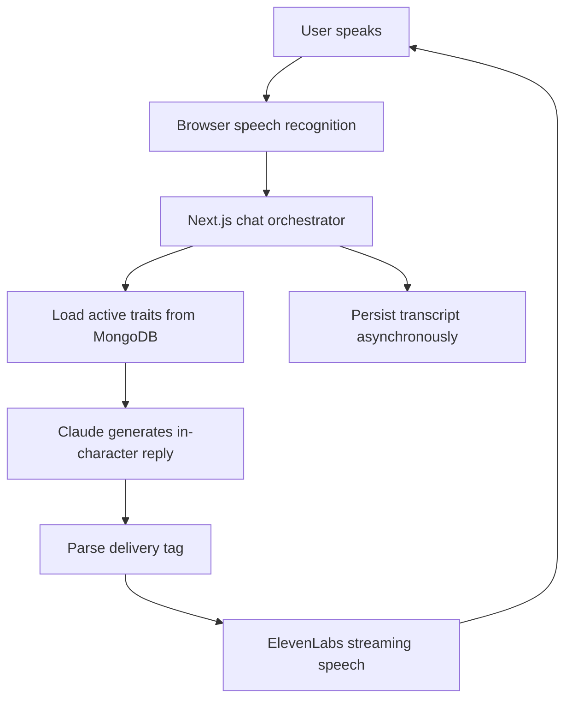
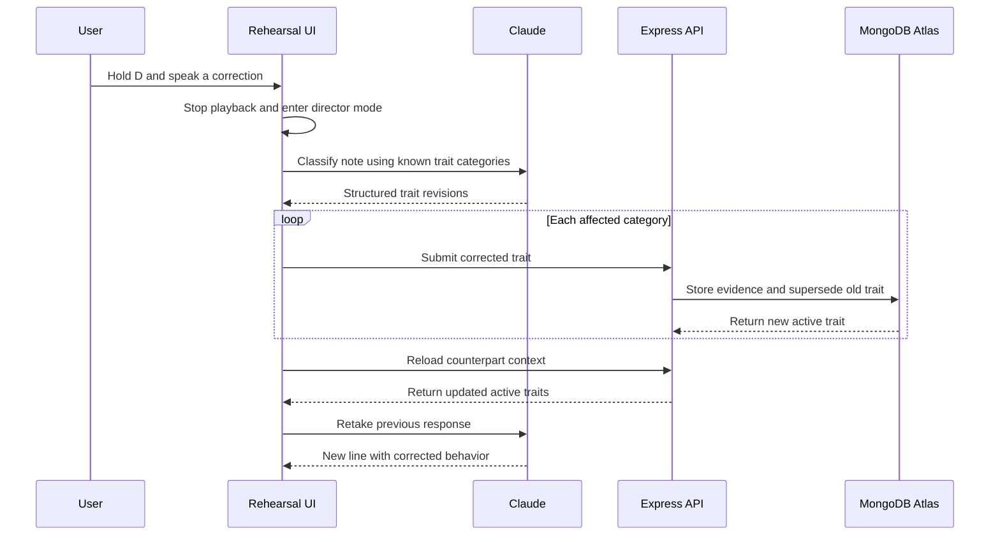
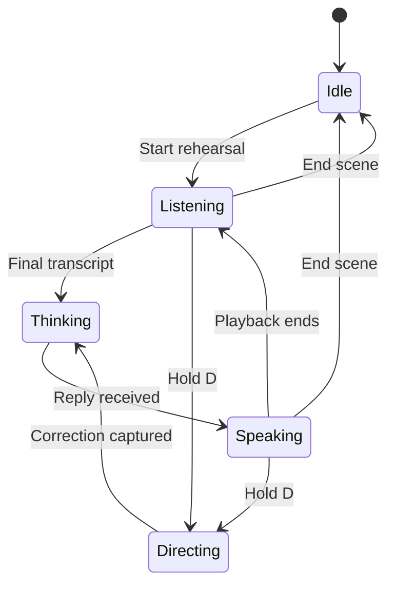
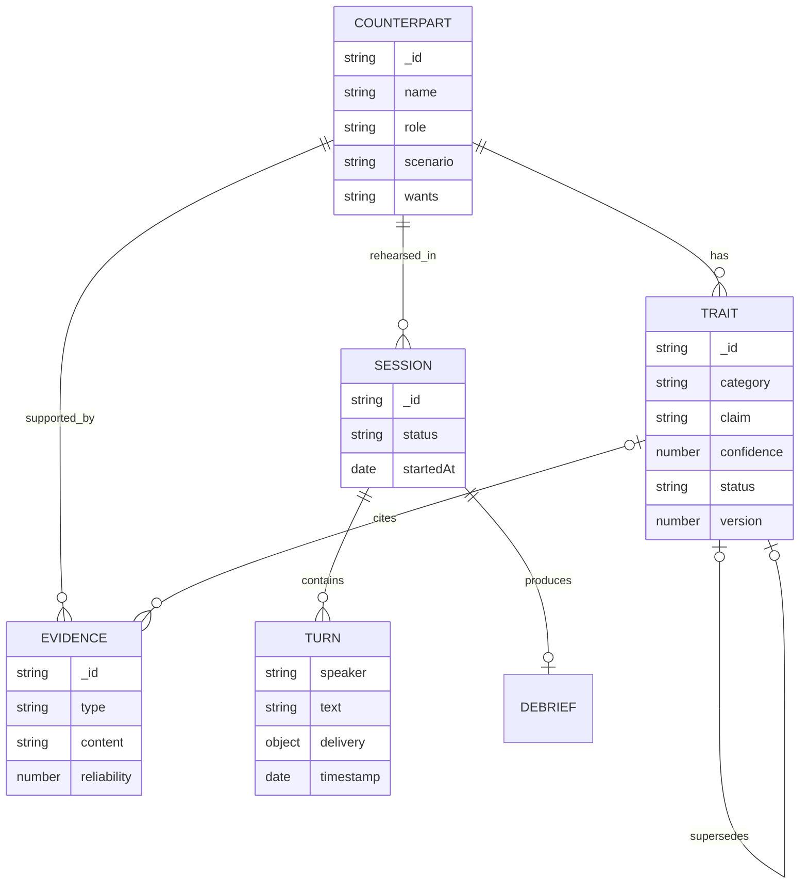

<div align="center">

# Rehearsal Room

### Practice the conversation before it matters.

A voice-first digital twin for difficult conversations. Describe the person you need to speak with, rehearse against a behavioral model of them, and correct the simulation in real time when it gets them wrong.

[](https://nextjs.org/)
[](https://react.dev/)
[](https://www.mongodb.com/atlas)
[](https://www.anthropic.com/claude)
[](https://elevenlabs.io/)
[](https://www.typescriptlang.org/)

Built during the **MongoDB Atlas Hackathon**.

</div>

---

## The idea

Difficult conversations are hard to prepare for because a script cannot push back, interrupt, deflect, or change tone the way a real person does.

Rehearsal Room creates an interactive counterpart from a description of the person and the situation. The counterpart has goals, boundaries, concessions, speech rules, and versioned behavioral traits. You speak naturally, hear a voice response, and see the conversation unfold through a live transcript.

The important part is that the simulation is **correctable**.

If the counterpart behaves unrealistically, hold the Director Interrupt and say what is wrong:

> “She would get quieter here, not more aggressive.”

The system maps that note to the relevant behavioral categories, stores the correction as evidence, supersedes the outdated traits, rebuilds the persona, and immediately performs a retake.

The model does not simply remember the note in the conversation history. Its persistent representation of the person changes.

## Why it is different

Most role-play assistants keep a persona inside one prompt. Rehearsal Room treats the persona as a living, inspectable data model.

| Capability                         | What happens                                                                                                         |
| ---------------------------------- | -------------------------------------------------------------------------------------------------------------------- |
| **Create any counterpart**         | Describe a person and situation in plain language. Claude converts it into a structured behavioral model.            |
| **Speak naturally**                | Browser speech recognition turns the conversation into a hands-free rehearsal.                                       |
| **Hear expressive responses**      | Model-generated delivery tags control pace, stability, style, and manner in ElevenLabs.                              |
| **Interrupt like a director**      | Cut off the counterpart mid-sentence and give a correction while the mistake is happening.                           |
| **Update behavior immediately**    | The old trait is superseded in MongoDB, and the next retake uses the corrected trait.                                |
| **See the memory change**          | The trait panel animates the old belief out and the corrected belief in.                                             |
| **Preserve an audit trail**        | Every correction stores evidence and maintains explicit trait version history.                                       |
| **Keep rehearsing during outages** | If memory is unavailable, the conversation continues in degraded mode and reports that corrections will not persist. |

## Example scenarios

The seed data includes three different conversations:

* **Vendor renewal:** Dana Reyes, a VP of Engineering, wants a 30% price reduction and uses a previous outage as leverage.
* **Rent negotiation:** Marcus Hale wants a 22% rent increase and creates pressure by mentioning other prospective tenants.
* **Promotion conversation:** Priya Shah avoids giving a direct no by becoming warmer and vaguer while appealing to process and calibration.

You can also add a new person from the interface. A free-form description is expanded into a complete, correctable persona with a stance, speech rules, and five behavioral traits.

## How the system works



The Next.js application acts as the orchestration layer. The browser communicates only with same-origin Next.js routes. Those routes call the Express service, Claude, and ElevenLabs without exposing API keys or the MongoDB connection string to the client.

## The Director Interrupt

The Director Interrupt is the central feature of Rehearsal Room.

When the simulation gets the person wrong, the user can interrupt the generated response and correct the counterpart while the mistake is happening.



A single natural-language note may contradict multiple parts of the behavioral model.

For example:

> “He would go cold, not stay chatty.”

This correction could revise both `conflict_response` and `conversation_style`.

The classifier is constrained to categories that already exist for the counterpart. It removes duplicate categories and limits one note to a maximum of three revisions so that a local correction cannot unexpectedly rewrite the entire personality.

## Voice state machine

The client uses a small state machine to coordinate the microphone, language model, and speaker without recording the generated voice as user input.



Director mode is push-to-talk instead of a toggle. Playback stops first, and then the microphone opens for the correction. This makes the interruption feel immediate and prevents the interface from accidentally remaining in correction mode.

## Behavioral memory

Each counterpart is assembled from structured state instead of a single hardcoded prompt.

### Counterpart profile

Every counterpart includes:

* Identity and role
* Conversation scenario
* The user’s role in the conversation
* Desired outcome
* Permitted concessions
* Hard boundaries
* Escalation behavior
* Maximum response length
* Speech habits

### Correctable traits

Every generated counterpart starts with one active trait in each category:

| Category             | Represents                                 |
| -------------------- | ------------------------------------------ |
| `conflict_response`  | How the person reacts when challenged      |
| `conversation_style` | Their recurring conversational habits      |
| `negotiation_tactic` | The leverage or strategy they use          |
| `hardening_trigger`  | What makes them less willing to compromise |
| `softening_trigger`  | What makes them more receptive             |

### Versioned corrections

A correction never overwrites history.

The backend performs three related writes inside a MongoDB transaction:

1. Insert a high-reliability `user_correction` evidence document.
2. Mark the current trait as `superseded` and connect it to its replacement.
3. Insert a new active trait with an incremented version and a link to the previous trait.

That produces an explicit version chain:

```text
trait v1 (superseded) → trait v2 (superseded) → trait v3 (active)
```

The application reconstructs the persona using only active traits. Previous versions remain available for provenance, inspection, and debugging.

## Expressive speech

Claude begins every in-character response with a compact delivery instruction:

```text
[pace|energy|manner] The line the counterpart actually says.
```

For example:

```text
[slow|flat|clipped] Thirty percent. Or I walk.
```

The tag is removed before speech synthesis and mapped to ElevenLabs voice controls.

| Dimension | Values                              | Voice effect                                    |
| --------- | ----------------------------------- | ----------------------------------------------- |
| Pace      | `slow`, `normal`, `fast`            | Adjusts playback speed                          |
| Energy    | `flat`, `warm`, `sharp`             | Adjusts stability and style                     |
| Manner    | `clipped`, `measured`, `dismissive` | Fine-tunes speed, stability, and expressiveness |

Unknown or missing tags safely fall back to:

```text
normal|flat|measured
```

Stability, style, and speed are clamped to tested ranges to prevent robotic or slurred audio. The previous counterpart line is also sent to the text-to-speech model to preserve prosody across turns.

## Tech stack

| Layer         | Technology                       | Responsibility                                                        |
| ------------- | -------------------------------- | --------------------------------------------------------------------- |
| Interface     | Next.js 15, React 19, TypeScript | Rehearsal stage, counterpart picker, transcript, and trait panel      |
| Speech input  | Web Speech API                   | Live and final browser transcription                                  |
| Reasoning     | Anthropic Claude                 | Persona generation, note classification, and in-character replies     |
| Speech output | ElevenLabs Turbo v2.5            | Low-latency streaming voice synthesis                                 |
| API           | Express 5, Node.js               | Counterparts, sessions, corrections, evidence, and debriefs           |
| Memory        | MongoDB Atlas                    | Versioned traits, supporting evidence, transcripts, and session state |
| Deployment    | Vercel                           | Next.js frontend and serverless Express backend                       |

## Repository structure

```text
.
├── frontend/
│   ├── app/
│   │   ├── api/
│   │   │   ├── chat/             # Turn orchestration and correction loop
│   │   │   ├── counterparts/     # List and AI-generate counterparts
│   │   │   ├── traits/           # Live active-trait view
│   │   │   └── tts/              # Streaming ElevenLabs proxy
│   │   └── page.tsx              # Rehearsal Room entry point
│   ├── components/rehearsal/      # Stage, mic, transcript, picker, and traits
│   └── lib/
│       ├── backend.ts             # Typed client for the Express service
│       ├── personas/              # Static fallback persona
│       └── voice/                 # Recognition, playback, delivery, and state
├── backend/
│   ├── api/index.js               # Vercel serverless entry point
│   ├── lib/db.js                  # Atlas connection and database indexes
│   ├── app.js                     # Express routes and transactions
│   ├── index.js                   # Local server entry point
│   └── seed.js                    # Seed data for three scenarios
└── voice-agent/                   # Voice-agent implementation notes
```

## Getting started

### Prerequisites

You will need:

* Node.js 20 or newer
* npm
* A MongoDB Atlas deployment
* An Anthropic API key
* An ElevenLabs API key with Text to Speech access
* Chrome or Edge for the Web Speech API

> [!IMPORTANT]
> Voice recognition relies on `webkitSpeechRecognition`, which is not supported by Safari or Firefox. The full voice experience requires Chrome or Edge.

### 1. Clone the repository

```bash
git clone https://github.com/kuatovakamila/digital-twin-hackathon-mongodb.git
cd digital-twin-hackathon-mongodb
```

### 2. Configure the backend

```bash
cd backend
cp .env.example .env
npm install
```

Set the following values in `backend/.env`:

```dotenv
MONGODB_URI=mongodb+srv://<username>:<password>@<cluster>/
PORT=3001
```

Seed the built-in counterparts:

```bash
npm run seed
```

Start the backend:

```bash
npm run dev
```

The seed is safe to run repeatedly. It resets only the three built-in counterparts and recreates their original traits and evidence.

Confirm that the backend is running:

```bash
curl http://localhost:3001/health
```

Expected response:

```json
{
  "status": "ok",
  "database": "connected"
}
```

### 3. Configure the frontend

Open a second terminal:

```bash
cd frontend
cp .env.local.example .env.local
npm install
```

Configure `frontend/.env.local`:

```dotenv
ANTHROPIC_API_KEY=sk-ant-...
CHAT_MODEL=claude-opus-5
CHAT_EFFORT=low

ELEVENLABS_API_KEY=sk_...
ELEVENLABS_VOICE_ID=EXAVITQu4vr4xnSDxMaL
ELEVENLABS_MODEL_ID=eleven_turbo_v2_5

BACKEND_URL=http://localhost:3001
```

Start the frontend:

```bash
npm run dev
```

Open http://localhost:3000, allow microphone access, select a counterpart, and begin rehearsing.

Headphones are recommended to prevent the generated speech from bleeding back into speech recognition.

## Available scripts

| Directory  | Command             | Purpose                                           |
| ---------- | ------------------- | ------------------------------------------------- |
| `frontend` | `npm run dev`       | Start the Next.js development server on port 3000 |
| `frontend` | `npm run build`     | Create a production build                         |
| `frontend` | `npm run start`     | Run the production build                          |
| `frontend` | `npm run typecheck` | Type-check without emitting files                 |
| `backend`  | `npm run dev`       | Start Express with Node watch mode                |
| `backend`  | `npm start`         | Start the Express server                          |
| `backend`  | `npm run seed`      | Reset and seed the built-in counterparts          |

## Using the app

### Rehearse a scene

1. Choose a counterpart from the picker.
2. Review the scenario and your role.
3. Select **Start rehearsal** and speak normally.
4. Watch the live transcript while the counterpart responds aloud.
5. Select **End scene** when finished.

### Correct the counterpart

1. While a rehearsal is active, hold **D** or the on-screen Director Interrupt button.
2. The counterpart’s audio stops immediately.
3. Say the behavioral correction, not a line of dialogue.
4. The system updates the relevant traits and creates a retake.
5. Watch the trait panel show the outgoing and incoming versions.

### Add someone new

Select **+ Add someone** and describe:

* Who they are
* What the conversation is about
* What you want from them
* How they tend to behave when pushed

Claude returns schema-constrained JSON containing the complete counterpart model.

The Express backend stores the profile and all five initial traits inside a MongoDB transaction. The new person then appears in the picker and can be corrected in the same way as the built-in counterparts.

## API reference

### Backend API

| Method | Endpoint                            | Description                                     |
| ------ | ----------------------------------- | ----------------------------------------------- |
| `GET`  | `/health`                           | Verify the API and Atlas connection             |
| `GET`  | `/api/counterparts`                 | List counterparts and active-trait counts       |
| `POST` | `/api/counterparts`                 | Create a counterpart and initial traits         |
| `GET`  | `/api/counterparts/:id/context`     | Fetch a profile, active traits, and evidence    |
| `POST` | `/api/counterparts/:id/corrections` | Supersede a trait and store correction evidence |
| `POST` | `/api/sessions`                     | Start a rehearsal session                       |
| `POST` | `/api/sessions/:sessionId/turns`    | Append a user or counterpart turn               |
| `POST` | `/api/sessions/:sessionId/debrief`  | Store observations and complete a session       |

### Next.js orchestration routes

| Method | Endpoint                        | Description                                                   |
| ------ | ------------------------------- | ------------------------------------------------------------- |
| `POST` | `/api/chat`                     | Load context, apply notes, generate a reply, and log the turn |
| `GET`  | `/api/counterparts`             | Retrieve the counterpart list                                 |
| `POST` | `/api/counterparts`             | Convert a free-text description into a stored persona         |
| `GET`  | `/api/traits?counterpartId=...` | Read the current active trait model                           |
| `POST` | `/api/tts`                      | Parse delivery instructions and stream MPEG audio             |

## Data model



MongoDB indexes counterpart, category, and status for active trait lookup. It also indexes session chronology, evidence chronology, and debrief lookup.

Transactions protect the two operations where partial state would be harmful:

* Creating a counterpart together with its initial traits
* Replacing an active trait with a corrected version

## Reliability and failure behavior

* **Memory failure:** The conversation continues using a static fallback persona. The interface reports that corrections will not persist.
* **Transcript logging failure:** Logging is asynchronous, so it never delays the generated response.
* **Stale trait request:** Requests are aborted or discarded when the selected counterpart changes.
* **Slow trait polling:** Only one request can be active at a time. The panel keeps the last known state instead of becoming blank.
* **TTS interruption:** Playback can be cancelled immediately when the user activates Director Interrupt.
* **Malformed delivery:** Missing or unknown delivery tags use safe defaults.
* **Unbounded correction:** Structured output is limited to known categories, de-duplicated, and capped at three revisions per note.

## Deployment

The repository contains two deployable applications:

1. Deploy `backend/` as a Node or Vercel project and configure `MONGODB_URI`.
2. Deploy `frontend/` as a Next.js project.
3. Set `BACKEND_URL` in the frontend deployment to the deployed backend URL.
4. Add the Anthropic and ElevenLabs credentials to the frontend’s server-side environment variables.

`backend/vercel.json` rewrites backend traffic to the serverless Express entry point at `backend/api/index.js`.

Keep every credential server-side. None of the environment variables in this README should use the `NEXT_PUBLIC_` prefix.

## Responsible use

Rehearsal Room is a practice tool, not a factual reconstruction of another person.

Generated counterparts are probabilistic simulations based on the description and corrections provided by the user. Their responses should not be treated as predictions, professional advice, or evidence of what a real person thinks.

Avoid entering confidential, sensitive, or identifying information without the appropriate permission.

## Future directions

* Generate a structured post-session debrief from the stored transcript
* Compare rehearsals over time to identify improvements
* Attach additional evidence to traits from notes or previous interactions
* Support multiple voice profiles and languages
* Add authentication and isolate counterpart data by user
* Add automated API, transaction, state-machine, and accessibility tests

---

<div align="center">

**Built to make the real conversation feel less like the first attempt.**

</div>
