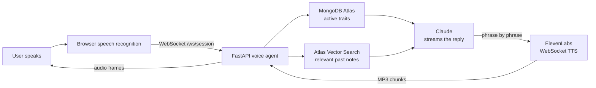
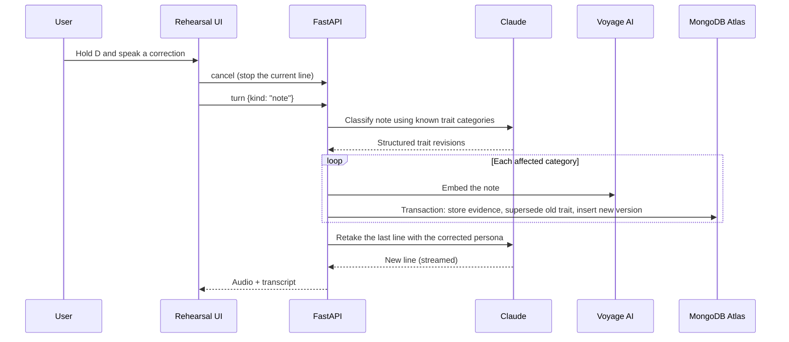
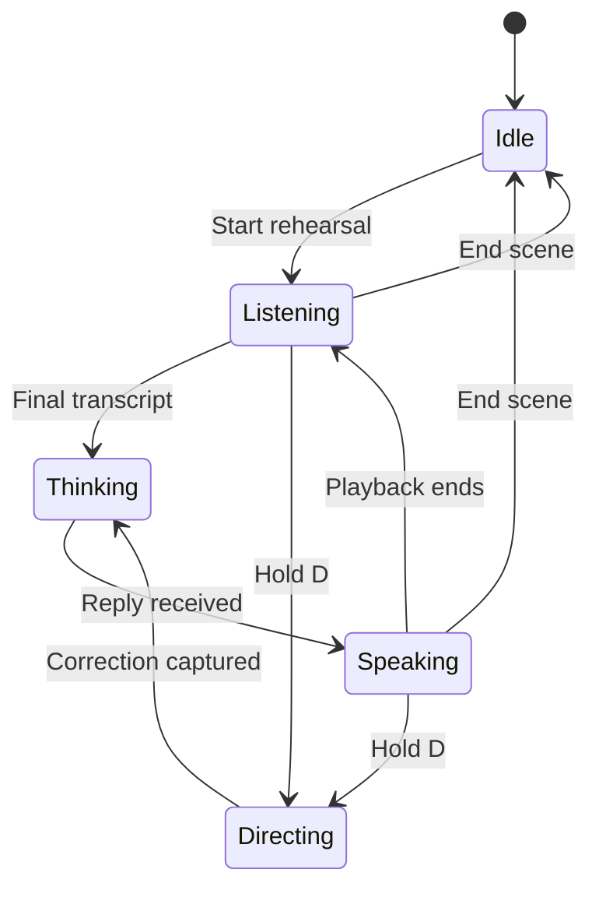
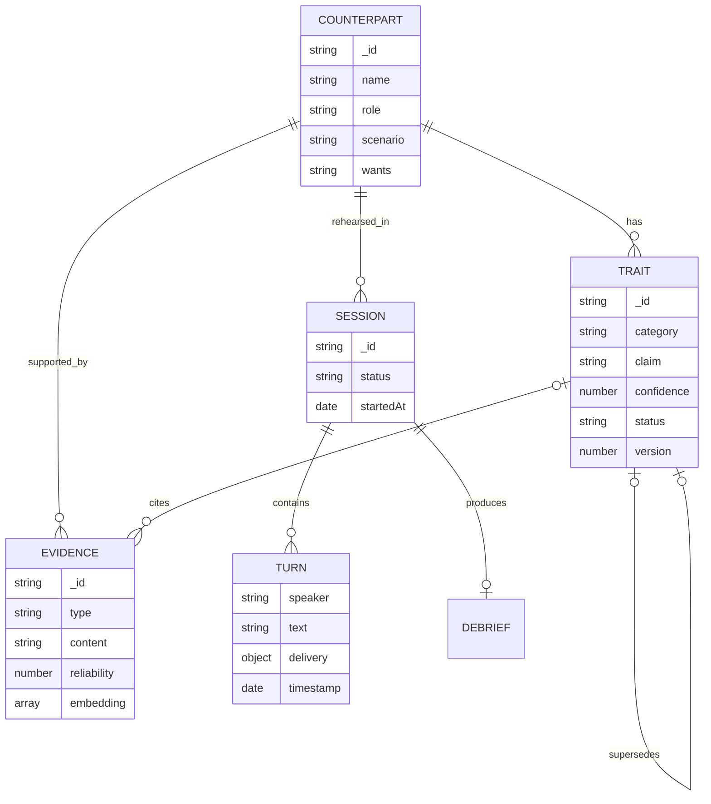

<div align="center">

# Rehearsal Room

### Real-Time AI Voice Agent with Vector Search

A low-latency conversational voice agent built on **Python / FastAPI**, **MongoDB Atlas Vector Search**, **Claude**, and **ElevenLabs**, with bidirectional audio streamed over **WebSockets**.

[](https://www.python.org/)
[](https://fastapi.tiangolo.com/)
[](https://www.mongodb.com/products/platform/atlas-vector-search)
[](https://www.anthropic.com/claude)
[](https://elevenlabs.io/)
[](https://nextjs.org/)

**Top 5 of 94 teams at the MongoDB AI Hackathon**

</div>

---

## Highlights

| | |
| --- | --- |
| **Real-time voice pipeline** | Speech in, an LLM reply streamed token by token, and synthesized audio streamed back, all overlapped instead of sequential. |
| **Bidirectional WebSockets** | One persistent socket per session between browser and FastAPI, and a second between FastAPI and ElevenLabs. Audio is pushed as it is generated; the user can barge in mid-sentence. |
| **Atlas Vector Search** | Every piece of user feedback is embedded with Voyage AI and retrieved by semantic similarity on each turn. **152 ms median, 238 ms p95** query time. |
| **~50% lower voice latency** | Median time to first audio cut from **2.61 s to 1.26 s** (deployed) by streaming end to end (see [benchmarks](#real-time-streaming)). |
| **Versioned agent memory** | Behaviour is stored as versioned MongoDB documents; corrections are applied in multi-document ACID transactions with a full audit trail. |
| **Tested** | 26 pytest tests against a real MongoDB, including transactions, vector search, and the WebSocket loop. |

## What it does

Rehearsal Room is a voice agent that plays a specific person you need to talk to: a vendor pushing back on price, a landlord raising the rent, a manager deferring a promotion. You speak out loud; it answers in character, in a voice whose pace and tone follow the moment.

The agent is **correctable while it talks**. If it behaves unrealistically, hold the Director Interrupt and say what is wrong:

> “She would get quieter here, not more aggressive.”

The note is classified into the behavioural traits it contradicts, stored and embedded as evidence, and the outdated traits are superseded by new versions. The agent then retakes its line with the corrected behaviour.

The agent does not just remember the note in its context window. Its persistent model of the person changes, and Atlas Vector Search brings the relevant notes back whenever a similar moment comes up later.

## Features

Most role-play assistants keep a persona inside one prompt. Rehearsal Room treats the persona as a living, inspectable data model.

| Capability                         | What happens                                                                                                         |
| ---------------------------------- | -------------------------------------------------------------------------------------------------------------------- |
| **Create any counterpart**         | Describe a person and situation in plain language. Claude converts it into a structured behavioral model.            |
| **Speak naturally**                | Browser speech recognition turns the conversation into a hands-free rehearsal.                                       |
| **Hear expressive responses**      | Model-generated delivery tags control pace, stability, style, and manner in ElevenLabs.                              |
| **Hear the reply almost at once**  | Claude's reply streams into ElevenLabs over WebSockets, so audio starts before the sentence is finished.             |
| **Remember what matters**          | Atlas Vector Search pulls the past director notes most relevant to what you just said into every reply.              |
| **Interrupt like a director**      | Cut off the counterpart mid-sentence and give a correction while the mistake is happening.                           |
| **Update behavior immediately**    | The old trait is superseded in MongoDB, and the next retake uses the corrected trait.                                |
| **See the memory change**          | The trait panel animates the old belief out and the corrected belief in.                                             |
| **Preserve an audit trail**        | Every correction stores evidence and maintains explicit trait version history.                                       |
| **Degrade gracefully**             | If vector search, embeddings, or the WebSocket fail, the turn still completes on a simpler path.                     |

## Example scenarios

The seed data includes three different conversations:

* **Vendor renewal:** Dana Reyes, a VP of Engineering, wants a 30% price reduction and uses a previous outage as leverage.
* **Rent negotiation:** Marcus Hale wants a 22% rent increase and creates pressure by mentioning other prospective tenants.
* **Promotion conversation:** Priya Shah avoids giving a direct no by becoming warmer and vaguer while appealing to process and calibration.

You can also add a new person from the interface. A free-form description is expanded into a complete, correctable persona with a stance, speech rules, and five behavioral traits.

## How the system works



The **FastAPI backend is the voice agent**. For each turn it:

1. loads the counterpart's active traits from MongoDB and, at the same time, runs **Atlas Vector Search** for the past notes most relevant to what the user said;
2. builds the persona prompt and **streams** Claude's reply token by token;
3. as soon as the delivery tag and the first phrase arrive, feeds them into the **ElevenLabs WebSocket**, which starts producing audio;
4. pushes each MP3 chunk to the browser over the same **WebSocket**, where it plays immediately;
5. saves the transcript in the background, after the user has heard the reply.

The browser holds one WebSocket open for the whole rehearsal. It can send a `cancel` at any moment (barge-in), and the server stops generating mid-sentence. All API keys live in the backend; the Next.js app is the interface.

## The Director Interrupt

The Director Interrupt is the central feature of Rehearsal Room.

When the simulation gets the person wrong, the user can interrupt the generated response and correct the counterpart while the mistake is happening.



A single natural-language note may contradict multiple parts of the behavioral model.

For example:

> “He would go cold, not stay chatty.”

This correction could revise both `conflict_response` and `conversation_style`.

The classifier is constrained to categories that already exist for the counterpart. It removes duplicate categories and limits one note to a maximum of three revisions so that a local correction cannot unexpectedly rewrite the entire personality.

## Voice state machine

The client uses a small state machine to coordinate the microphone, language model, and speaker without recording the generated voice as user input.



Director mode is push-to-talk instead of a toggle. Playback stops first, and then the microphone opens for the correction. This makes the interruption feel immediate and prevents the interface from accidentally remaining in correction mode.

## Behavioral memory

Each counterpart is assembled from structured state instead of a single hardcoded prompt.

### Counterpart profile

Every counterpart includes:

* Identity and role
* Conversation scenario
* The user’s role in the conversation
* Desired outcome
* Permitted concessions
* Hard boundaries
* Escalation behavior
* Maximum response length
* Speech habits

### Correctable traits

Every generated counterpart starts with one active trait in each category:

| Category             | Represents                                 |
| -------------------- | ------------------------------------------ |
| `conflict_response`  | How the person reacts when challenged      |
| `conversation_style` | Their recurring conversational habits      |
| `negotiation_tactic` | The leverage or strategy they use          |
| `hardening_trigger`  | What makes them less willing to compromise |
| `softening_trigger`  | What makes them more receptive             |

### Versioned corrections

A correction never overwrites history.

The backend performs three related writes inside a MongoDB transaction:

1. Insert a high-reliability `user_correction` evidence document.
2. Mark the current trait as `superseded` and connect it to its replacement.
3. Insert a new active trait with an incremented version and a link to the previous trait.

That produces an explicit version chain:

```text
trait v1 (superseded) → trait v2 (superseded) → trait v3 (active)
```

The application reconstructs the persona using only active traits. Previous versions remain available for provenance, inspection, and debugging.

## Atlas Vector Search

Every director note is stored as an `evidence` document. When it is saved, the backend also embeds it with **Voyage AI** (`voyage-3.5-lite`, 1024 dimensions) and stores the vector in the same document.

On every turn, the user's line is embedded the same way and an Atlas `$vectorSearch` returns the three closest notes for that counterpart:

```python
{"$vectorSearch": {
    "index": "evidence_vector_index",
    "path": "embedding",
    "queryVector": query_vector,
    "numCandidates": 50,
    "limit": 3,
    "filter": {"counterpartId": counterpart_id},  # never mix people up
}}
```

The results go into the persona prompt as *relevant past notes*. Matching is by meaning, not words: after the note *"she gets icy and asks for a written incident report"*, the line *"About the March downtime, we're really sorry"* retrieves it, and the counterpart answers *"Sorry. Fine. Is there a written incident report?"*

Search is best-effort: if it is slow or fails, the turn continues without it. Embedding happens before the correction transaction, so the transaction stays short.

| Measured over 50 queries     | Median | p95    |
| ---------------------------- | ------ | ------ |
| Embed the line (Voyage)      | 76 ms  | 121 ms |
| `$vectorSearch` (Atlas)      | 73 ms  | 157 ms |
| **Total query time**         | **152 ms** | **238 ms** |

## Real-time streaming

Without streaming, a turn waits for Claude's whole reply before any speech is generated. With streaming, the stages overlap:

```text
Claude:      [tag][Five percent?][ On a number I already said was too high?]
ElevenLabs:            [audio.............................................]
Browser:                [plays............................................]
```

- **Browser ↔ FastAPI:** one WebSocket per rehearsal (`/ws/session`). No handshake per turn, audio pushed the moment it exists, and barge-in on the same connection.
- **FastAPI ↔ ElevenLabs:** the `stream-input` WebSocket, opened while Claude is still thinking. Text is sent phrase by phrase with `flush`, so audio starts after the first phrase.
- **Claude:** `messages.stream()`, with Claude Haiku 5.5 chosen as the fastest model to first word.

Time from the user's line to the first audio byte, 20 scripted turns (`bench/`):

| Path                                   | Median     | p95    |
| -------------------------------------- | ---------- | ------ |
| Before: HTTP, full reply, then TTS     | 2.61 s     | 3.39 s |
| WebSocket streaming, Claude Opus 5     | 1.84 s     | 2.85 s |
| WebSocket streaming, Claude Sonnet 5.5 | 1.50 s     | 1.83 s |
| WebSocket streaming, Claude Haiku 5.5 (laptop) | 1.20–1.41 s | 1.40–2.12 s |
| **WebSocket streaming, Claude Haiku 5.5 (deployed)** | **1.26 s** | **1.47 s** |

Laptop runs pay extra round trips from the laptop to Atlas. The deployed row is measured inside the server on Render (Oregon, next to the Atlas cluster), from receiving the user's line to sending the first audio byte. Each turn reports its own per-stage timing (`prepareMs`, `claudeFirstTokenMs`, `deliveryTagMs`, `firstPhraseSentMs`, `firstAudioMs`) in the WebSocket `done` message.

## Expressive speech

Claude begins every in-character response with a compact delivery instruction:

```text
[pace|energy|manner] The line the counterpart actually says.
```

For example:

```text
[slow|flat|clipped] Thirty percent. Or I walk.
```

The tag is removed before speech synthesis and mapped to ElevenLabs voice controls.

| Dimension | Values                              | Voice effect                                    |
| --------- | ----------------------------------- | ----------------------------------------------- |
| Pace      | `slow`, `normal`, `fast`            | Adjusts playback speed                          |
| Energy    | `flat`, `warm`, `sharp`             | Adjusts stability and style                     |
| Manner    | `clipped`, `measured`, `dismissive` | Fine-tunes speed, stability, and expressiveness |

Unknown or missing tags safely fall back to:

```text
normal|flat|measured
```

Stability, style, and speed are clamped to tested ranges to prevent robotic or slurred audio. The mapping lives in `server/app/agent/delivery.py`.

## Tech stack

| Layer         | Technology                       | Responsibility                                                        |
| ------------- | -------------------------------- | --------------------------------------------------------------------- |
| Interface     | Next.js 15, React 19, TypeScript | Rehearsal stage, counterpart picker, transcript, and trait panel      |
| Speech input  | Web Speech API                   | Live and final browser transcription                                  |
| Voice agent   | Python, FastAPI, PyMongo (async) | Turn orchestration, Claude calls, streaming, corrections, sessions    |
| Real-time     | WebSockets                       | Browser ↔ FastAPI and FastAPI ↔ ElevenLabs, audio streamed both ways   |
| Reasoning     | Claude Haiku 5.5                 | Streamed in-character replies, note classification, persona creation  |
| Speech output | ElevenLabs Turbo v2.5            | Streaming voice synthesis over the `stream-input` WebSocket           |
| Memory        | MongoDB Atlas                    | Versioned traits, supporting evidence, transcripts, and session state |
| Retrieval     | Atlas Vector Search, Voyage AI   | Finds the past director notes most relevant to each line              |
| Deployment    | Vercel, Render                   | Next.js frontend on Vercel, FastAPI backend on Render                 |

## Repository structure

```text
.
├── server/                          # Python + FastAPI: the voice agent
│   ├── app/
│   │   ├── main.py                  # App setup, startup, error format
│   │   ├── db.py                    # Atlas connection and indexes
│   │   ├── schemas.py               # Pydantic request models
│   │   ├── embeddings.py            # Voyage AI embeddings
│   │   ├── agent/
│   │   │   ├── claude.py            # Every Claude call
│   │   │   ├── prompt.py            # Persona prompt from traits + vector search notes
│   │   │   ├── delivery.py          # Delivery tag -> ElevenLabs voice settings
│   │   │   └── voice_stream.py      # Claude stream -> ElevenLabs WebSocket -> audio
│   │   └── routes/
│   │       ├── voice_socket.py      # WebSocket /ws/session
│   │       ├── turn.py              # One turn over HTTP (and shared preparation)
│   │       ├── search.py            # Atlas Vector Search endpoint
│   │       ├── counterparts.py      # People, versioned traits, corrections
│   │       ├── sessions.py          # Sessions, transcript turns, debriefs
│   │       └── tts.py               # Speech over HTTP (fallback path)
│   ├── scripts/                     # Vector index creation, embedding backfill
│   ├── tests/                       # pytest suite (26 tests, real MongoDB)
│   ├── seed.py, seed_data.json      # The three built-in scenarios
│   └── README.md                    # Backend file-by-file guide
├── frontend/                        # Next.js interface
│   ├── app/api/                     # Pass-through routes to FastAPI
│   ├── components/rehearsal/        # Stage, mic, transcript, picker, traits
│   └── lib/voice/                   # Mic, playback, WebSocket client, session state
├── bench/                           # Latency benchmarks and results
└── render.yaml                      # Render blueprint for the backend
```

## Getting started

### Prerequisites

You will need:

* Python 3.12+ and [uv](https://docs.astral.sh/uv/)
* Node.js 20 or newer and npm
* A MongoDB Atlas cluster (the free M0 tier works)
* A Voyage AI key (Atlas → AI Model APIs; add a payment method to lift the 3 requests/minute limit)
* An Anthropic API key
* An ElevenLabs API key with Text to Speech access
* Chrome or Edge for the Web Speech API

> [!IMPORTANT]
> Voice recognition relies on `webkitSpeechRecognition`, which is not supported by Safari or Firefox. The full voice experience requires Chrome or Edge.

### 1. Clone the repository

```bash
git clone https://github.com/assemkdv/mongodb-ai-hackathon.git
cd mongodb-ai-hackathon
```

### 2. Configure the backend

```bash
cd server
cp .env.example .env
```

Fill in `server/.env`. Every key lives here:

```dotenv
MONGODB_URI=mongodb+srv://<username>:<password>@<cluster>/
VOYAGE_API_KEY=...
ANTHROPIC_API_KEY=sk-ant-...
ELEVENLABS_API_KEY=sk_...
```

Seed the built-in counterparts, embed their notes, and create the vector index:

```bash
uv run python seed.py
uv run python -m scripts.backfill_embeddings
uv run python -m scripts.create_vector_index
```

Start the backend:

```bash
uv run uvicorn app.main:app --reload --port 3001
```

The seed is safe to run repeatedly. It resets only the three built-in counterparts and recreates their original traits and evidence.

Confirm that the backend is running:

```bash
curl http://localhost:3001/health
```

Expected response:

```json
{
  "status": "ok",
  "database": "connected"
}
```

### 3. Configure the frontend

Open a second terminal:

```bash
cd frontend
cp .env.local.example .env.local   # backend URLs only; no API keys
npm install
```

Start the frontend:

```bash
npm run dev
```

Open http://localhost:3000, allow microphone access, select a counterpart, and begin rehearsing.

Headphones are recommended to prevent the generated speech from bleeding back into speech recognition.

## Available scripts

| Directory  | Command             | Purpose                                           |
| ---------- | ------------------- | ------------------------------------------------- |
| `frontend` | `npm run dev`       | Start the Next.js development server on port 3000 |
| `frontend` | `npm run build`     | Create a production build                         |
| `frontend` | `npm run start`     | Run the production build                          |
| `frontend` | `npm run typecheck` | Type-check without emitting files                 |
| `server`   | `uv run uvicorn app.main:app --reload --port 3001` | Start FastAPI with auto-reload |
| `server`   | `uv run python seed.py` | Reset and seed the built-in counterparts      |
| `server`   | `uv run python -m scripts.create_vector_index` | Create the Atlas Vector Search index |
| `server`   | `uv run python -m scripts.backfill_embeddings` | Embed notes that have no vector yet  |
| `server`   | `uv run pytest -q`  | Run the backend tests                             |
| `bench`    | `uv run --project ../server python bench_ws.py <label>` | Voice latency over WebSocket |
| `bench`    | `uv run --project ../server python bench_search.py` | Vector search latency    |

## Using the app

### Rehearse a scene

1. Choose a counterpart from the picker.
2. Review the scenario and your role.
3. Select **Start rehearsal** and speak normally.
4. Watch the live transcript while the counterpart responds aloud.
5. Select **End scene** when finished.

### Correct the counterpart

1. While a rehearsal is active, hold **D** or the on-screen Director Interrupt button.
2. The counterpart’s audio stops immediately.
3. Say the behavioral correction, not a line of dialogue.
4. The system updates the relevant traits and creates a retake.
5. Watch the trait panel show the outgoing and incoming versions.

### Add someone new

Select **+ Add someone** and describe:

* Who they are
* What the conversation is about
* What you want from them
* How they tend to behave when pushed

Claude returns schema-constrained JSON containing the complete counterpart model.

The FastAPI backend stores the profile and all five initial traits inside a MongoDB transaction. The new person then appears in the picker and can be corrected in the same way as the built-in counterparts.

## API reference

### Backend API

| Method | Endpoint                            | Description                                     |
| ------ | ----------------------------------- | ----------------------------------------------- |
| `GET`  | `/health`                           | Verify the API and Atlas connection             |
| `GET`  | `/api/counterparts`                 | List counterparts and active-trait counts       |
| `POST` | `/api/counterparts`                 | Create a counterpart and initial traits         |
| `GET`  | `/api/counterparts/:id/context`     | Fetch a profile, active traits, and evidence    |
| `POST` | `/api/counterparts/:id/corrections` | Supersede a trait and store correction evidence |
| `POST` | `/api/counterparts/:id/search`      | Atlas Vector Search over past notes (top 3)     |
| `POST` | `/api/sessions`                     | Start a rehearsal session                       |
| `POST` | `/api/sessions/:sessionId/turns`    | Append a user or counterpart turn               |
| `POST` | `/api/sessions/:sessionId/debrief`  | Store observations and complete a session       |
| `POST` | `/api/counterparts/generate`        | Free-text description → stored counterpart      |
| `POST` | `/api/turn`                         | One rehearsal turn over HTTP (fallback)         |
| `POST` | `/api/tts`                          | Speech for one line over HTTP (fallback)        |
| `WS`   | `/ws/session`                       | The real-time voice loop (below)                |

### WebSocket protocol: `/ws/session`

| Direction        | Message                                                         | Meaning                                  |
| ---------------- | --------------------------------------------------------------- | ---------------------------------------- |
| browser → server | `{"type": "turn", "kind": "line" \| "note", "text", ...}`       | The user said a line, or gave a note     |
| browser → server | `{"type": "cancel"}`                                            | Barge-in: stop the current line          |
| server → browser | binary frame                                                    | MP3 audio, played as it arrives          |
| server → browser | `{"type": "reply", "reply": "[tag] line", "correction"?, ...}`  | The line's text, for the transcript      |
| server → browser | `{"type": "done", "timing": {"firstAudioMs", ...}}`             | Turn finished, with server timing        |
| server → browser | `{"type": "error", "error": "..."}`                             | The turn failed                          |

### Next.js routes (thin pass-throughs to FastAPI)

| Method | Endpoint                        | Forwards to                         |
| ------ | ------------------------------- | ----------------------------------- |
| `POST` | `/api/chat`                     | `POST /api/turn`                    |
| `POST` | `/api/tts`                      | `POST /api/tts`                     |
| `GET`  | `/api/counterparts`             | `GET /api/counterparts`             |
| `POST` | `/api/counterparts`             | `POST /api/counterparts/generate`   |
| `GET`  | `/api/traits?counterpartId=...` | `GET /api/counterparts/:id/context` |

## Data model



MongoDB indexes counterpart, category, and status for active trait lookup. It also indexes session chronology, evidence chronology, and debrief lookup. The `evidence_vector_index` Atlas Vector Search index covers `evidence.embedding` (cosine similarity) with a `counterpartId` filter.

Transactions protect the two operations where partial state would be harmful:

* Creating a counterpart together with its initial traits
* Replacing an active trait with a corrected version

## Reliability and failure behavior

* **WebSocket unavailable:** The browser falls back to the HTTP path (`/api/chat` then `/api/tts`).
* **Vector search failure:** The turn continues without past notes.
* **Embedding failure on a correction:** The correction is still saved; the backfill script embeds it later.
* **Correction failure:** The retake still plays, and the interface reports that the note was not stored.
* **Transcript logging failure:** Logging happens after the reply, so it never delays it.
* **Stale trait request:** Requests are aborted or discarded when the selected counterpart changes.
* **Slow trait polling:** Only one request can be active at a time. The panel keeps the last known state instead of becoming blank.
* **Barge-in:** The browser stops playback and sends `cancel`; the server stops Claude and ElevenLabs mid-sentence.
* **Malformed delivery:** Missing or unknown delivery tags use safe defaults.
* **Unbounded correction:** Structured output is limited to known categories, de-duplicated, and capped at three revisions per note.

## Deployment

- **Backend (Render):** `render.yaml` is a Render blueprint. Choose *New → Blueprint*, select this repository, and enter the four secrets when asked (`MONGODB_URI`, `VOYAGE_API_KEY`, `ANTHROPIC_API_KEY`, `ELEVENLABS_API_KEY`). It runs in Oregon, the same region as the Atlas cluster. In Atlas, allow access from `0.0.0.0/0` (Render has no fixed IP on the free plan).
- **Frontend (Vercel):** import the repository with `frontend/` as the root directory and set:
  - `BACKEND_URL=https://<your-render-service>.onrender.com`
  - `NEXT_PUBLIC_BACKEND_WS_URL=wss://<your-render-service>.onrender.com/ws/session`

The WebSocket URL is public by design (the browser connects to it). Every secret stays in the backend.

## Responsible use

Rehearsal Room is a practice tool, not a factual reconstruction of another person.

Generated counterparts are probabilistic simulations based on the description and corrections provided by the user. Their responses should not be treated as predictions, professional advice, or evidence of what a real person thinks.

Avoid entering confidential, sensitive, or identifying information without the appropriate permission.

## Future directions

* Generate a structured post-session debrief from the stored transcript
* Compare rehearsals over time to identify improvements
* Attach additional evidence to traits from notes or previous interactions
* Support multiple voice profiles and languages
* Add authentication and isolate counterpart data by user
* Add browser tests for the voice state machine and accessibility

---

<div align="center">

**Python · FastAPI · WebSockets · MongoDB Atlas Vector Search · Claude · ElevenLabs**

</div>
